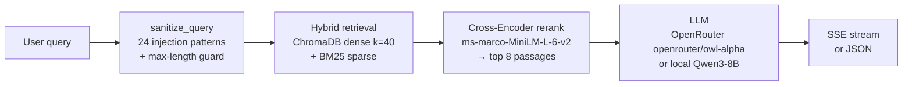

<div align="center">

# 🏋️ WallFit-RAG

**A Retrieval-Augmented Generation (RAG) women's-fitness coach — "Coach WahibaFit" — grounded in research papers, health journalism, and structured exercise data.**

Multilingual (English, French, Arabic, Darija) · Hybrid retrieval · Cross-encoder reranking · Streaming FastAPI + web chat UI

[](https://github.com/RYOMA-SyY/WallFit-RAG)
[](https://github.com/RYOMA-SyY/WallFit-RAG/commits/master)
[](https://github.com/RYOMA-SyY/WallFit-RAG/stargazers)
[](https://github.com/RYOMA-SyY/WallFit-RAG)
[](#-why-this-exists)

</div>

> [!WARNING]
> **Internship project, not production software.** Built during a BTS internship for W.ALLfit / Coach WahibaFit. It answers fitness questions — it does **not** replace medical advice, and it has no safety validation beyond a rule-based filter. No license file is included; all rights are reserved by the author unless noted.

---

## 🧭 Table of Contents

- [What this is](#-what-this-is)
- [Why this exists](#-why-this-exists)
- [How it works](#-how-it-works)
- [Features](#-features)
- [Tech stack](#-tech-stack)
- [Repository layout](#-repository-layout)
- [Quick start](#-quick-start)
- [API endpoints](#-api-endpoints)
- [Evaluation](#-evaluation)
- [Knowledge base](#-knowledge-base)
- [Known limitations](#-known-limitations)
- [Internship reports](#-internship-reports)
- [Disclaimer & license](#-disclaimer--license)

---

## 🧠 What this is

**WallFit-RAG** implements **Coach WahibaFit**, a Moroccan fitness coach persona that answers fitness, nutrition, and health questions for women — "sister to sister", with an emphasis on evidence-based, culturally aware coaching.

It is a hybrid (dense + sparse) retrieval pipeline over a curated corpus — research papers, health-website articles, and exercise/health datasets — with a reranker and a guarded, streaming LLM backend. It was built end-to-end during a BTS internship and shipped with a FastAPI backend, a standalone HTML chat UI, and an automated evaluation harness.

## 🎓 Why this exists

This repo is the working artifact of an internship at **W.ALLfit** — the full code, the knowledge base, the evaluation harness, and the internship report (in French & English) are included. It is published as a portfolio/engineering sample, not as a maintained product.

## 🏗️ How it works



The pipeline follows the same design in two delivery forms in this repo:

- `wallfit_rag/` — the packaged engine (`RAGEngine` with `config.py`, `engine.py`, `security.py`) used by the FastAPI server, and
- `WallfitAI RAG COLAB/` — the original Colab notebook + standalone script (the development version).

Indexing (`scripts/index_data.py`) happens **offline** and applies PII masking (emails, phone numbers, card numbers, API keys) to documents *before* embedding. Security at query time lives in `wallfit_rag/security.py` (prompt-injection filtering).

## ✨ Features

- **Hybrid retrieval** — ChromaDB (`all-MiniLM-L6-v2` dense vectors) merged with BM25 keyword search
- **Cross-encoder reranking** — `cross-encoder/ms-marco-MiniLM-L-6-v2`, keeps the top-8 passages
- **Security layer** — 24-regex prompt-injection filter + query length cap; PII masking at index time
- **Streaming** — Server-Sent Events with configurable `WALLFIT_STREAM_DELAY` / `WALLFIT_MESSAGE_DELAY` for a "natural chat" feel
- **Multilingual persona** — English, French, Arabic and Moroccan Darija, with language mirroring
- **Session memory** — in-memory chat history (max 10 turns), user-context pre-loading, session summarization, metrics extraction
- **Laravel-style integration endpoints** — `/v1/user/context`, `/v1/session/summarize`, `/v1/metrics/extract`, `/v1/generate/structured-plan`
- **Evaluation harness** — 50 test cases across 9 categories
- **Web UI** — WhatsApp-style chat (`api/templates/index.html`), "Listen" voice playback via the browser's Web Speech API, Markdown rendering

## 🛠️ Tech stack

| Component | Technology (pinned in `requirements.txt`) |
|---|---|
| API | FastAPI 0.136.1 + Uvicorn 0.46.0 |
| Orchestration | LangChain 1.2.17 (+ `langchain-community`, `langchain-huggingface`, `langchain-core`) |
| Vector store | ChromaDB 1.5.8 (`sentence-transformers/all-MiniLM-L6-v2`) |
| Keyword search | `rank_bm25` 0.2.2 |
| Reranker | `cross-encoder/ms-marco-MiniLM-L-6-v2` (Sentence-Transformers 5.4.1) |
| LLM backends | OpenRouter (`openrouter/owl-alpha`, default) or local `Qwen/Qwen3-8B` |
| Parsing | pypdf 6.10.2, python-docx 1.2.0, docx2txt 0.9 |
| Data | Pandas 3.0.2 |

## 📁 Repository layout

```
├── wallfit_rag/              # RAG engine package (engine.py, config.py, security.py)
├── api/
│   ├── main.py               # FastAPI app: /health, /v1/query (SSE), Laravel sync endpoints
│   └── templates/index.html  # standalone WhatsApp-style chat UI
├── scripts/
│   ├── index_data.py         # build the Chroma vector store (+ PII masking at index time)
│   ├── evaluate_bot.py       # 50-case evaluation runner → markdown report
│   └── evaluation_set.json   # the 50 test cases
├── Evaluation/               # small evaluation subset (10 cases)
├── DataSet/                  # knowledge base
│   ├── *.pdf                 # research papers (Harvard, IJERPH, MC-PHASES, NIHMS)
│   ├── webs/                 # curated articles (Healthline, Prevention, PubMed, …)
│   └── Exercices DS/         # exercise & health CSVs (NHANES, gym tracking, 77 MB set)
├── WallfitAI RAG COLAB/      # original Colab notebook (Wallfit.ipynb) + standalone script
├── scratch/                  # internship-report tooling (docx/pdf utilities)
├── Rapport_SFE.pdf / Rapport_de_Stage_BTS1_V3_15jours.docx
├── documentation.md          # architecture, config, API reference, scaling notes
├── requirements.txt          # pinned dependencies
└── README.md
```

## ⚡ Quick start

```bash
python -m venv .venv
.\.venv\Scripts\activate        # Windows
# source .venv/bin/activate      # Linux/macOS
pip install -r requirements.txt
```

Configure `.env` in the project root:

```bash
OPENROUTER_API_KEY=sk-or-v1-...        # required by default (api backend)
OPENAI_MODEL=openrouter/owl-alpha      # default model
WALLFIT_GENERATION_BACKEND=api         # or: local (Qwen3-8B)
```

Index the knowledge base (builds `./chroma_db/`, which is gitignored):

```bash
$env:PYTHONPATH="."; python scripts\index_data.py     # Windows (PowerShell)
# PYTHONPATH="." python scripts/index_data.py          # Linux/macOS
```

Run the server and open the UI:

```bash
$env:PYTHONPATH="."; python -m uvicorn api.main:app --host 0.0.0.0 --port 8000
# http://localhost:8000
```

To query without an LLM in dev: `WALLFIT_SKIP_LLM=1` disables generator loading.

## 🔌 API endpoints

| Method | Endpoint | Purpose |
|--------|----------|---------|
| GET | `/health` | engine + LLM readiness |
| POST | `/v1/query` | main chat — SSE token stream (`data: {"token": ...}` … `data: [DONE]`) |
| POST | `/v1/user/context` | pre-load user profile into a session |
| POST | `/v1/session/summarize` | structured summary of a session |
| POST | `/v1/metrics/extract` | numerical metrics (e.g. weight) |
| POST | `/v1/generate/structured-plan` | workout plan as renderable JSON |

Example:

```bash
curl -N -X POST http://localhost:8000/v1/query \
  -H "Content-Type: application/json" \
  -d '{"query": "I weigh 70kg and want to start light for my back", "session_id": "s1"}'
```

## 🧪 Evaluation

`scripts/evaluation_set.json` contains **50 test cases** across 9 categories (Fitness 12, Nutrition 10, Language 7, Persona 4, Security 4, Medical 4, Edge Case 4, Formatting 4, Off‑topic 1):

```bash
$env:PYTHONPATH="."; python scripts\evaluate_bot.py
```

The author reported ≈ **4.4–4.5 / 5** responses. Those scores were produced with the full LLM backend and are **not reproducible from the repo alone** — and `.env`, the vector store, and the API key you would need to re-run them are not included. The `Evaluation/evaluation_set.json` (10 cases) is a small subset of the same suite.

## 📚 Knowledge base

The shipped corpus (`DataSet/`) bundles: four research PDFs (Harvard, IJERPH, MC‑PHASES, NIHMS), six curated web articles, and four exercise/health CSVs. It is heterogenous and not peer-reviewed as a whole; it was curated for a coaching audience, not as medical guidance. The PDFs and article texts remain the property of their respective publishers — they are included here for reproducibility of the internship system; do not redistribute them as your own.

## ⚠️ Known limitations

- No license file (all rights reserved); internship deliverable, not a maintained library
- `allow_origins=["*"]` on CORS; **in-memory** session storage (lost on restart, not horizontally scalable)
- No automated tests beyond the LLM evaluation harness; no CI
- Persona breadth (Darija) is supported by design but not systematically benchmarked
- Claims like "production-grade" in earlier docs describe intent; treat it as a prototype-to-demo system
- The largest CSV (77 MB) is committed directly — clones are heavy
- Not medical advice; no clinical safety gating

## 📝 Internship reports

- `Rapport_de_Stage_BTS1_V3_15jours.docx` — full internship report
- `Rapport_SFE.pdf` — matching exported analysis
- `documentation.md` — architecture, API reference, scaling notes (1000+ users)
- `scratch/` — tooling used to generate the reports

## 🚑 Disclaimer & license

This project provides **general fitness and health information, not medical advice**. Consult a physician before starting a new exercise or nutrition program, especially with pre-existing conditions. The author makes no warranty of fitness for any medical purpose.

**License:** none provided — all rights reserved by the author. Derived health-article and paper content remains the property of the original publishers. Contact the author before any reuse.

## 🙏 Acknowledgements

- **W.ALLfit / Coach WahibaFit** — the internship host and project context
- The English/Darija health-web sources included for corpus-building (PubMed, Healthline, Prevention, Verywell, Women's Health)
- Standing on LangChain, ChromaDB, Sentence-Transformers, FastAPI, and the OpenRouter/Hugging Face ecosystems
